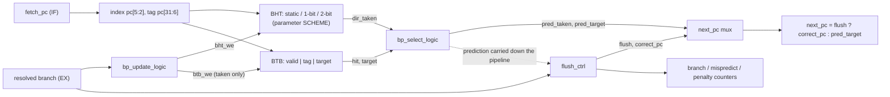
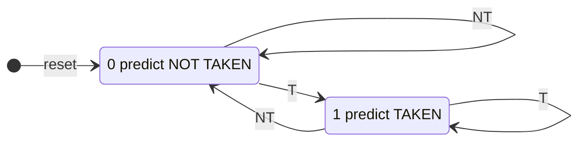
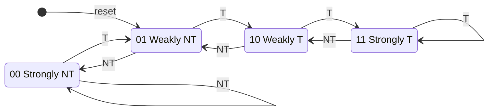
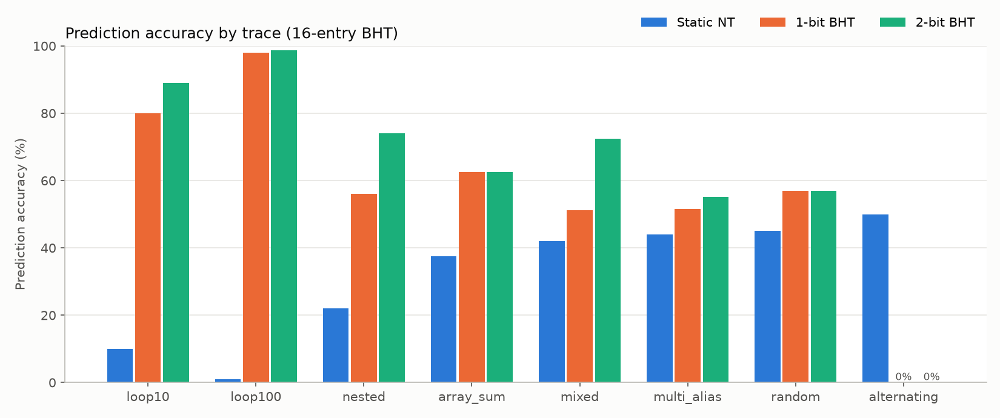
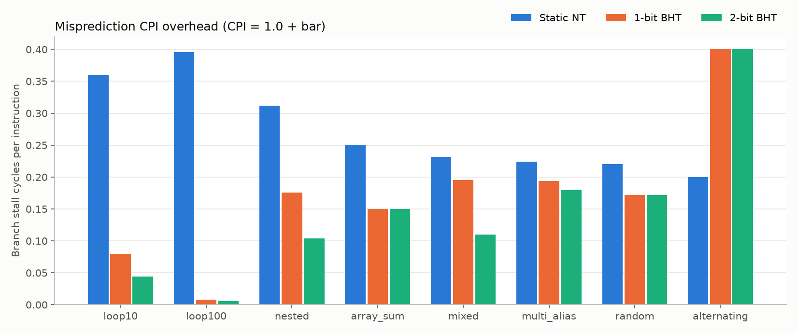
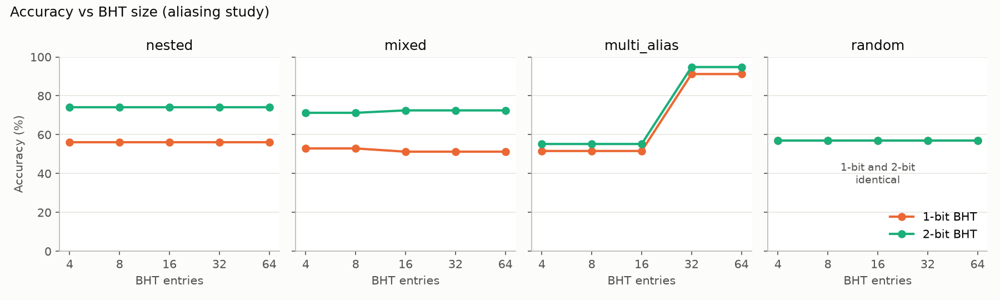

# Dynamic Branch Prediction Unit
### MCA Project 5 — Modern Computer Architecture (Verilog Projects)

**Team:** Arun · Keshav · Mayank · Rohit · Sarvesh
**Tools:** Icarus Verilog 13 (simulation), GTKWave (waveforms), Yosys 0.71 (synthesis), Python 3 + matplotlib (traces, golden model, analysis)

---

## Abstract

We designed, implemented and verified a synthesizable branch-prediction unit for a 5-stage MIPS-style pipeline. Three prediction strategies were built and compared: an always-not-taken baseline, a 1-bit Branch History Table (BHT) and a 2-bit saturating-counter BHT. Each is combined with a tagged Branch Target Buffer (BTB) and a pipeline flush/control interface. Correctness was established with four directed testbenches and a trace-driven testbench. That testbench compared every prediction of the RTL with an independent Python golden model on eight BEQ/BNE traces, one of them produced by executing a real MIPS program: 64 out of 64 simulation runs matched. Pooled over all 1,256 branches, the 2-bit predictor reached 68.31 % accuracy against 61.94 % (1-bit) and 30.33 % (static not-taken), and reduced the estimated CPI from 1.2787 to 1.1268. On loop-dominated code, the 2-bit predictor reached 89–98.67 % accuracy and up to a 1.389× speedup over the baseline. The 2-bit design costs only 16 flip-flops more than the 1-bit design.

---

## 1. Problem: Control Hazards and the Misprediction Penalty
*(Section author: Mayank)*

In the classic five-stage pipeline (IF–ID–EX–MEM–WB), a conditional branch (`BEQ`, `BNE`) compares its registers in the ALU, so the outcome and target are known only at the end of EX. During that time the IF stage keeps fetching:

```
cycle:        1     2     3     4     5
BNE  (i)     IF    ID    EX    MEM   WB      <- outcome known at end of EX
i+1          .     IF    ID    xx            <- wrong path if the guess was wrong
i+2          .     .     IF    xx            <- wrong path if the guess was wrong
correct      .     .     .     IF    ID
```

If fetch followed the wrong path, the two younger instructions are squashed (flushed), which costs **2 cycles** (EX stage 3 − IF stage 1). This is a **control hazard**. A branch predictor guesses the outcome and target in IF, so the penalty is paid only when the guess is wrong.

There are two kinds of misprediction:
- **Direction:** `pred_taken != actual_taken`
- **Target:** predicted taken and actually taken, but `pred_target != actual_target` (for example, a BTB miss)

**CPI model** (assumptions are parameters of `python/metrics.py` and `python/analyze.py`):

```
CPI = base_CPI + branch_freq × mispredict_rate × mispredict_penalty
base_CPI = 1.0   branch_freq = 0.2   mispredict_penalty = 2 cycles
```

---

## 2. Architecture
*(Section author: Keshav)*



| Module | File | Function | Owner |
|---|---|---|---|
| `static_not_taken` | `rtl/static_not_taken.v` | baseline: always predicts not taken | Arun |
| `bht_1bit` | `rtl/bht_1bit.v` | 1-bit history per entry, `state <= actual_taken` | Arun |
| `bht_2bit` | `rtl/bht_2bit.v` | `CTR_WIDTH`-bit saturating counters, predict MSB | Arun |
| `btb` | `rtl/btb.v` | direct-mapped valid/tag/target, combinational lookup | Keshav |
| `bp_update_logic` | `rtl/bp_update_logic.v` | BHT write on every branch, BTB write on taken | Keshav |
| `bp_select_logic` | `rtl/bp_select_logic.v` | `pred_taken`, `pred_target = hit ? target : pc+4` | Keshav |
| `branch_predictor_top` | `rtl/branch_predictor_top.v` | `generate`-selected scheme + BTB + update + selection | Keshav |
| `flush_ctrl` | `rtl/flush_ctrl.v` | misprediction detection, flush, `correct_pc`, counters | Mayank |
| `bpu_top` | `rtl/bpu_top.v` | complete unit: predictor + flush control + `next_pc` mux | Mayank |

Parameters: `PC_WIDTH = 32`, `BHT_INDEX_BITS = 4` (16 entries), `BTB_INDEX_BITS = 4`, `CTR_WIDTH = 2`, `SCHEME ∈ {0, 1, 2}`, `MISPREDICT_PENALTY = 2`.

**Indexing and aliasing.** Both tables use `pc[INDEX_BITS+1:2]`, because `pc[1:0]` is always `00` for word-aligned instructions. The BHT has no tag, so two branches whose PCs differ by a multiple of `entries × 4` bytes share a counter (**aliasing**). The BTB stores a tag (`pc[31:6]` for 16 entries), so an aliasing lookup becomes a safe miss instead of a wrong target.

---

## 3. Predictor State Machines
*(Section author: Arun)*

### 3.1 1-bit predictor



| State | Prediction | Input NT → | Input T → |
|---|---|---|---|
| 0 | NT | 0 | 1 |
| 1 | T | 0 | 1 |

### 3.2 2-bit saturating counter



| Present | Prediction | Input NT → | Input T → |
|---|---|---|---|
| 00 strongly NT | NT | 00 (saturate) | 01 |
| 01 weakly NT | NT | 00 | 10 |
| 10 weakly T | T | 01 | 11 |
| 11 strongly T | T | 10 | 11 (saturate) |

**Hysteresis:** from a strong state, one opposite outcome does not change the prediction. At a loop exit the counter drops from `11` to `10` and still predicts *taken* when the loop is re-entered. The 1-bit predictor instead stores *not taken* at the exit and mispredicts a second time on re-entry.

---

## 4. Implementation Details

**Direction predictors (Arun).** `bht_1bit` holds a `2^N`-bit register. `bht_2bit` holds an array of `CTR_WIDTH`-bit counters, with a `next_state()` function that implements the saturating increment and decrement. Reads are combinational, so the prediction is available in the same IF cycle. Writes happen on the rising edge when `update_en` is high. On reset, a `for` loop (unrolled at synthesis) sets every counter to `01`.

**BTB, update and selection logic (Keshav).** `btb` resets only its valid bits. The tag and target arrays have no reset, so FPGA synthesis maps them to distributed LUTRAM. `bp_update_logic` writes the BHT for every resolved branch and the BTB only for taken branches. `bp_select_logic` outputs `pred_taken = is_branch & dir_taken` and uses the BTB target only when the branch is predicted taken **and** the BTB hits; otherwise `pc + 4`. `branch_predictor_top` instantiates the predictor chosen by `SCHEME` through `generate`, so only that predictor is built in hardware and each scheme can be synthesized separately.

**Pipeline control (Mayank).** `flush_ctrl` computes `dir_mispredict`, `tgt_mispredict`, `mispredict`, `flush = resolve_en & mispredict` and `correct_pc = actual_taken ? actual_target : pc + 4`. It also counts branches, mispredictions and penalty cycles (`+MISPREDICT_PENALTY` per misprediction). `bpu_top` connects the predictor (IF port) with `flush_ctrl` (EX port, which receives the prediction carried down the pipeline) and selects `next_pc = flush ? correct_pc : pred_target`. A misprediction in EX therefore has priority over the new prediction in IF.

**Verification infrastructure (Rohit, Sarvesh).** `python/ref_model.py` re-implements the unit bit-exactly in Python. `testbench/tb_predictor.v` reads a CSV trace and the model's expectation file, drives one branch per clock, and checks `pred_taken`, `btb_hit`, `pred_target`, `mispredict` and `next_pc`. It also checks the invariant that `next_pc` equals the architecturally correct next PC for every branch, and that the hardware counters equal its own counts. The first mismatch is reported with its branch number and cycle.

---

## 5. Branch Traces
*(Section author: Rohit; `array_sum` by Mayank)*

Format (`traces/*.csv`): `pc,type,taken,target`, for example `00400010,BNE,1,00400000`.

| Trace | Generator | Branches | Taken | Pattern / purpose |
|---|---|---:|---:|---|
| `loop10` | `gen_traces.py` | 100 | 90 | 10-iteration loop × 10 runs: exit/re-entry cost |
| `loop100` | `gen_traces.py` | 300 | 297 | 100-iteration loop × 3: long loops |
| `nested` | `gen_traces.py` | 50 | 39 | inner 4 × outer 10 |
| `alternating` | `gen_traces.py` | 100 | 50 | T, NT, T, NT: adversarial |
| `random` | `gen_traces.py` | 200 | 110 | one branch, 50 % random (seed 7): no pattern |
| `multi_alias` | `gen_traces.py` | 250 | 140 | 5 branches; `0x00400410` and `0x00400450` share BHT index 4 with opposite bias |
| `mixed` | `gen_traces.py` | 240 | 139 | loop + data-dependent `if` (30 %, seed 2026) + periodic `if` |
| `array_sum` | `mips_trace.py` | 16 | 10 | executed MIPS array-sum program (BEQ skip-zero, BNE loop) |

`python/mips_trace.py` assembles the array-sum program, prints the machine code (`beq $t3,$zero,skip` = `0x11600001`, `bne $t0,$t1,loop` = `0x1509fffa`), executes it on a small interpreter, checks the result (sum = 26), and records every executed branch.

---

## 6. Verification

| Testbench | Owner | What it proves | Result |
|---|---|---|---|
| `tb_bht_fsm.v` | Arun | reset values; all 8 transitions of the 2-bit FSM; saturation at 00 and 11; all 4 transitions of the 1-bit FSM; steady-state loop exit/re-entry: 1-bit = 2 misses per loop, 2-bit = 1 | PASS |
| `tb_btb.v` | Keshav | cold miss, fill on taken, alias tag miss, conflict eviction, independent indices, target update, no write without enable, reset clear | PASS |
| `tb_flush_ctrl.v` | Mayank | NT/NT, T/T, NT→T, T→NT, wrong target; `flush`, `correct_pc`; counters 5/3/6 | PASS |
| `tb_bpu_top.v` | Mayank | integrated unit: cold miss, trained hit, loop exit, **target misprediction through BHT aliasing**, non-branch, flush priority over IF prediction, counters 7/4/8 | PASS |
| `tb_predictor.v` | Sarvesh | 8 traces × 3 schemes, plus 40 BHT-size runs, compared branch-by-branch with the golden model; `next_pc` invariant; counter cross-check | **64 / 64 PASS** |

The comparison was shown to be sensitive: when the golden model's 2-bit reset value was deliberately changed from `01` to `00`, the testbench reported `MISMATCH at branch 1` and `FAIL`.

All RTL compiles with `iverilog -Wall` without warnings. Logs are in `results/logs/`.

---

## 7. Results
*(Section author: Sarvesh. Source: `results/accuracy_table.md`, generated by `make report`.)*

### 7.1 Overall comparison (all 1,256 branches pooled)

| Scheme | Branches | Correct | Accuracy % | Mispredictions | Mispredict rate % | CPI | Speedup vs NT |
|---|---:|---:|---:|---:|---:|---:|---:|
| Static NT | 1256 | 381 | 30.33 | 875 | 69.67 | 1.2787 | 1.000 |
| 1-bit BHT | 1256 | 778 | 61.94 | 478 | 38.06 | 1.1522 | 1.110 |
| 2-bit BHT | 1256 | 858 | 68.31 | 398 | 31.69 | 1.1268 | 1.135 |

### 7.2 Per-trace accuracy and CPI

| Trace | Scheme | Accuracy % | Mispredictions | BTB hit % | CPI | Speedup vs NT |
|---|---|---:|---:|---:|---:|---:|
| loop10 | Static NT | 10.00 | 90 | 99.00 | 1.3600 | 1.000 |
| loop10 | 1-bit BHT | 80.00 | 20 | 99.00 | 1.0800 | 1.259 |
| loop10 | 2-bit BHT | 89.00 | 11 | 99.00 | 1.0440 | 1.303 |
| loop100 | Static NT | 1.00 | 297 | 99.67 | 1.3960 | 1.000 |
| loop100 | 1-bit BHT | 98.00 | 6 | 99.67 | 1.0080 | 1.385 |
| loop100 | 2-bit BHT | 98.67 | 4 | 99.67 | 1.0053 | 1.389 |
| nested | Static NT | 22.00 | 39 | 96.00 | 1.3120 | 1.000 |
| nested | 1-bit BHT | 56.00 | 22 | 96.00 | 1.1760 | 1.116 |
| nested | 2-bit BHT | 74.00 | 13 | 96.00 | 1.1040 | 1.188 |
| array_sum | Static NT | 37.50 | 10 | 81.25 | 1.2500 | 1.000 |
| array_sum | 1-bit BHT | 62.50 | 6 | 81.25 | 1.1500 | 1.087 |
| array_sum | 2-bit BHT | 62.50 | 6 | 81.25 | 1.1500 | 1.087 |
| mixed | Static NT | 42.08 | 139 | 97.08 | 1.2317 | 1.000 |
| mixed | 1-bit BHT | 51.25 | 117 | 97.08 | 1.1950 | 1.031 |
| mixed | 2-bit BHT | 72.50 | 66 | 97.08 | 1.1100 | 1.110 |
| multi_alias | Static NT | 44.00 | 140 | 58.80 | 1.2240 | 1.000 |
| multi_alias | 1-bit BHT | 51.60 | 121 | 58.80 | 1.1936 | 1.025 |
| multi_alias | 2-bit BHT | 55.20 | 112 | 58.80 | 1.1792 | 1.038 |
| random | Static NT | 45.00 | 110 | 99.50 | 1.2200 | 1.000 |
| random | 1-bit BHT | 57.00 | 86 | 99.50 | 1.1720 | 1.041 |
| random | 2-bit BHT | 57.00 | 86 | 99.50 | 1.1720 | 1.041 |
| alternating | Static NT | 50.00 | 50 | 99.00 | 1.2000 | 1.000 |
| alternating | 1-bit BHT | 0.00 | 100 | 99.00 | 1.4000 | 0.857 |
| alternating | 2-bit BHT | 0.00 | 100 | 99.00 | 1.4000 | 0.857 |





### 7.3 BHT size sensitivity (accuracy %, BTB fixed at 16 entries)

| Trace | Scheme | 4 | 8 | 16 | 32 | 64 entries |
|---|---|---:|---:|---:|---:|---:|
| nested | 1-bit | 56.00 | 56.00 | 56.00 | 56.00 | 56.00 |
| nested | 2-bit | 74.00 | 74.00 | 74.00 | 74.00 | 74.00 |
| mixed | 1-bit | 52.92 | 52.92 | 51.25 | 51.25 | 51.25 |
| mixed | 2-bit | 71.25 | 71.25 | 72.50 | 72.50 | 72.50 |
| multi_alias | 1-bit | 51.60 | 51.60 | 51.60 | 91.20 | 91.20 |
| multi_alias | 2-bit | 55.20 | 55.20 | 55.20 | 94.80 | 94.80 |
| random | 1-bit | 57.00 | 57.00 | 57.00 | 57.00 | 57.00 |
| random | 2-bit | 57.00 | 57.00 | 57.00 | 57.00 | 57.00 |



### 7.4 Waveform verification

Command: `make wave`, then `gtkwave results/waveforms/predictor_loop10.vcd results/waveforms/predictor.gtkw`.
The save file shows `clk, rst, pc, pred_taken, actual_taken, counter_state, btb_hit, pred_target, actual_target, mispredict, flush, correct_pc, next_pc, mispredict_count, penalty_cycles`.

First 12 branches of `loop10` with the 2-bit scheme (the RTL and the golden model agree):

| Branch | counter_state | pred_taken | actual | btb_hit | pred_target | mispredict / flush | next_pc |
|---:|---|---|---|---|---|---|---|
| 0 | 01 | 0 | 1 | 0 | 00400014 | **1** | 00400000 |
| 1 | 10 | 1 | 1 | 1 | 00400000 | 0 | 00400000 |
| 2–8 | 11 | 1 | 1 | 1 | 00400000 | 0 | 00400000 |
| 9 (exit) | 11 | 1 | 0 | 1 | 00400000 | **1** | 00400014 |
| 10 (re-entry) | **10** | **1** | 1 | 1 | 00400000 | 0 | 00400000 |
| 11 | 11 | 1 | 1 | 1 | 00400000 | 0 | 00400000 |

Branch 0 is the cold start: the counter is `01` and the BTB is empty, so the flush redirects fetch to `0x00400000`. Branch 9 is the loop exit: the counter is `11`, the prediction is wrong, and the counter drops to `10`. At branch 10 (re-entry), the weakly-taken counter still predicts taken, which is correct. This is the cycle in which the 1-bit predictor mispredicts a second time.

### 7.5 Synthesis (Yosys 0.71, complete `bpu_top`, 16-entry BHT/BTB)

Source: `results/synthesis/synthesis_summary.md` (`make synth`).

| Scheme | Generic cells | Flip-flops | Latches | Logic depth | Xilinx LUTs | Xilinx FFs | CARRY4 | LUTRAM (RAM32M) |
|---|---:|---:|---:|---:|---:|---:|---:|---:|
| Static NT | 1885 | 527 | 0 | 31 | 135 | 111 | 42 | 5 |
| 1-bit BHT | 2921 | 1055 | 0 | 31 | 197 | 127 | 42 | 11 |
| 2-bit BHT | 3029 | 1071 | 0 | 31 | 214 | 143 | 42 | 11 |

`check -assert` passed for every scheme (no latches, no undriven nets, no combinational loops). In the generic flow, the 2-bit flip-flop count is 928 BTB tag/target bits + 16 valid bits + 32 counter bits + 95 performance-counter bits. One bit of `penalty_cycles` is constant 0, because the counter always grows by 2. In the Xilinx flow, the BTB arrays move into distributed LUTRAM. For static NT, Yosys removes the BTB target RAM altogether, because `pred_target` is always `pc+4` when nothing is ever predicted taken.

---

## 8. Comparison and Analysis

1. **2-bit beats 1-bit on loops.** On `loop10`, the 1-bit predictor mispredicts twice per loop visit (exit and re-entry), giving 20 mispredictions. The 2-bit predictor mispredicts once per visit, plus one warm-up, giving 11. CPI improves from 1.0800 to 1.0440. The effect is strongest for short loops: on `nested` (inner loop of 4), accuracy rises from 56 % to 74 %. For long loops (`loop100`), both schemes exceed 98 %, because the 1–2 mispredictions are spread over 100 iterations.
2. **Dynamic prediction vs the baseline.** Static not-taken is wrong on every taken branch: 1 % accuracy on `loop100`. The 2-bit scheme gives a 1.389× speedup there, and 1.135× pooled over all traces.
3. **Pathological pattern.** On `alternating`, both dynamic schemes reach 0 % and are worse than static NT (50 %). The 1-bit predictor always repeats the last outcome, and the 2-bit counter oscillates between `01` and `10`. Patterns that depend on history need correlating predictors (for example gshare).
4. **No pattern, no gain.** On `random` (55 % taken), the 1-bit and 2-bit schemes are identical at 57 %. Both only exploit bias, and this branch has almost none.
5. **Biased data-dependent branches.** On `mixed`, the 2-bit scheme (72.50 %) clearly beats the 1-bit scheme (51.25 %). Its hysteresis follows the 70 %-not-taken bias of the random `if`, while the 1-bit predictor flips after every rare outcome.
6. **Aliasing.** In `multi_alias`, an always-taken and an always-not-taken branch share BHT index 4 for every table of up to 16 entries, which holds accuracy at 51.60 % / 55.20 %. At 32 entries they separate and accuracy jumps to 91.20 % / 94.80 %. Aliasing can also be mildly *constructive*: on `mixed`, a 4-entry 1-bit BHT (52.92 %) beats a 16-entry one (51.25 %). In `tb_bpu_top`, aliasing also produced a **target** misprediction: the shared counter predicted taken, but the tagged BTB correctly missed.
7. **Size sensitivity.** Once each active branch has its own entry, extra entries do not help (`nested` and `random` are flat). Table size must match the working set of branches.
8. **Cost.** 2-bit over 1-bit costs 16 flip-flops (generic: +108 cells, +3.7 %; FPGA: +17 LUTs) for up to an 18-point accuracy gain on loop code. The BTB dominates area.

---

## 9. Limitations

- The predictor is evaluated with branch traces, not inside a running 5-stage CPU. Each branch updates the tables before the next branch is predicted, so there are no overlapping in-flight branches.
- CPI is an analytical estimate (base CPI 1.0, branch frequency 0.2, penalty 2). It ignores data hazards, cache misses and the exact wrong-path work.
- The traces are short and synthetic, except `array_sum`, which is a real but tiny program (16 branches) dominated by warm-up.
- Maximum clock frequency is not reported. Yosys gives logic depth (31 levels) and cell counts; Fmax needs place-and-route with timing constraints (for example Vivado).
- The BTB is direct-mapped with 16 entries. There is no return-address stack and no indirect-jump prediction.
- Verilator lint was not run (not installed); `iverilog -Wall` and Yosys `check -assert` are clean.

---

## 10. Conclusion

A complete, parameterized and synthesizable branch-prediction unit was built and verified. All three strategies run through the same hardware interface. All state transitions and the target, flush and priority behaviour are covered by directed tests, and every prediction on 1,256 trace branches per scheme matches an independent golden model. The 2-bit saturating counter is the best of the three on loop-oriented code: it halves the loop exit/re-entry mispredictions of the 1-bit scheme for 16 extra flip-flops, and it reduces the estimated CPI by up to 28 % compared with static not-taken (1.3960 → 1.0053 on `loop100`). The experiments also show the limits of simple counters: alternating patterns defeat them, random branches give them nothing to learn, and destructive aliasing in a small untagged BHT can remove most of their benefit. Global-history (gshare) and tournament predictors are the natural next steps.

---

## Appendix A — Reproducing every number

```bash
make test     # traces, 4 directed testbenches, 24 trace runs, 40 sweep runs
make report   # tables and charts in results/
make wave     # VCD waveforms
make synth    # synthesis tables
```

## Appendix B — Viva Questions (summary)

1. **Why does the 2-bit counter reset to `01`?** One taken outcome then switches the prediction to taken. From `00`, the predictor would need two taken outcomes and pay an extra warm-up miss.
2. **What is hysteresis?** From a strong state, a single surprise does not change the prediction. This filters out the one not-taken outcome at a loop exit.
3. **Why is the penalty 2 cycles?** The branch resolves in EX (stage 3). The instructions in IF and ID are on the wrong path and are squashed.
4. **Why does the BTB need a tag but not the BHT?** A wrong direction only costs cycles. A wrong target fetches unrelated code, and the tag turns that into a safe miss.
5. **Why store only taken branches in the BTB?** The not-taken path is `pc+4`, which an adder computes for free.
6. **What is a target misprediction?** A correct taken prediction with a wrong or missing target. `tb_bpu_top` case D demonstrates it.
7. **How is the testbench self-checking?** Every output of every branch is compared with the golden model. The first mismatch is reported with its cycle, and a deliberate mutation of the model was caught.
8. **When is 2-bit no better than 1-bit?** For alternating patterns (both 0 %) and for random branches without bias (both 57 %).
9. **Why does a bigger BHT not always help?** It only helps when it removes aliasing (`multi_alias` at 32 entries). Otherwise the extra entries are unused.
10. **Why is `SCHEME` a parameter?** Only the selected predictor is synthesized, which allows a per-scheme area comparison (2921 vs 3029 cells).
