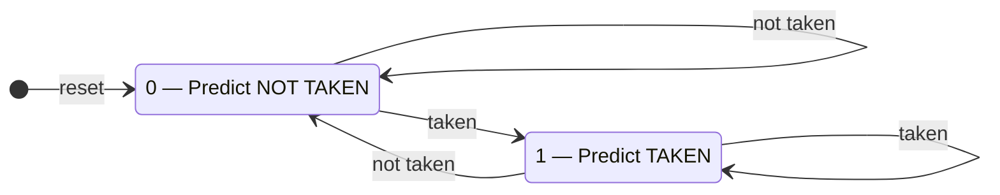
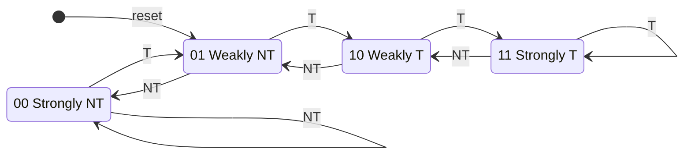

# Part 1 of 5 — Direction Predictors and BHT State Machines

**Project:** Dynamic Branch Prediction Unit (Project 5, *Modern Computer Architecture – Verilog Projects*)
**Member:** Arun
**Role:** Predictor-core designer (workflow steps 1–3: baseline → 1-bit → 2-bit)

---

## 1. Team Division at a Glance

| Part | Member | Responsibility | Source files in the repository |
|---|---|---|---|
| 1 | Arun | Direction predictors: static baseline, 1-bit BHT, 2-bit BHT, FSM verification | `rtl/static_not_taken.v`, `rtl/bht_1bit.v`, `rtl/bht_2bit.v`, `testbench/tb_bht_fsm.v` |
| 2 | Keshav | BTB, update/selection logic, predictor top level, build system, synthesis | `rtl/btb.v`, `rtl/bp_update_logic.v`, `rtl/bp_select_logic.v`, `rtl/branch_predictor_top.v`, `testbench/tb_btb.v`, `synth/synth.ys`, `python/synth_report.py`, `Makefile`, `README.md` |
| 3 | Mayank | Pipeline flush/control, integrated unit `bpu_top`, MIPS workload | `rtl/flush_ctrl.v`, `rtl/bpu_top.v`, `testbench/tb_flush_ctrl.v`, `testbench/tb_bpu_top.v`, `python/mips_trace.py` |
| 4 | Rohit | Branch traces and the Python golden reference model | `python/trace_io.py`, `python/gen_traces.py`, `python/ref_model.py`, `traces/*.csv` |
| 5 | Sarvesh | System testbench, regression, accuracy/CPI analysis, final report | `testbench/tb_predictor.v`, `python/metrics.py`, `python/run_regression.py`, `python/analyze.py`, `results/`, `docs/report.md` |

> **The repository files are authoritative.** Code listings in this guide explain the design; where they differ from the file in the repository, the repository version is the one that was simulated and verified. Every file you own starts with a `// Owner:` or `Owner:` header line.

## 2. Your Responsibilities

1. Implement the **always-not-taken baseline** (`static_not_taken.v`).
2. Implement the **1-bit Branch History Table** (`bht_1bit.v`).
3. Implement the **2-bit saturating-counter BHT** (`bht_2bit.v`), with a parameterised counter width.
4. Write the **directed FSM testbench** (`testbench/tb_bht_fsm.v`) covering:
   - all 8 transitions of the 2-bit FSM (4 states × 2 inputs),
   - saturation at `00` and at `11`,
   - all 4 transitions of the 1-bit FSM,
   - the **loop exit and re-entry** behaviour, where the 2-bit predictor mispredicts once per loop and the 1-bit predictor mispredicts twice.
5. Write **report Section 3** (FSM diagrams and transition tables) and the **predictor part of Section 4** (implementation details).
6. Prepare the viva answers on FSM behaviour (Section 10 of this file).

**Evaluation criteria you directly satisfy:** *"correct state transitions"* and *"predictor update behavior"*.

---

## 3. Background Theory

### 3.1 Why a direction predictor is needed

In the 5-stage MIPS pipeline (IF–ID–EX–MEM–WB), a conditional branch (`BEQ`, `BNE`) is resolved only in the EX stage. By then, the fetch stage has already fetched two more instructions. If the processor guessed wrong, those instructions must be flushed. This is a **control hazard** (Mayank covers the pipeline view in detail). A predictor guesses the outcome in the **IF** stage, so fetch can continue on the most likely path.

### 3.2 The Branch History Table (BHT)

The BHT is a small memory indexed by the low-order bits of the branch PC. It is similar to the **register file** from the course (one write port, here one read port), except that each entry holds prediction state instead of data.

```
 31                           INDEX+2 INDEX+1        2  1 0
 ┌────────────────────────────────┬─────────────────┬─────┐
 │     (ignored by the BHT)       │   BHT index     │ 00  │
 └────────────────────────────────┴─────────────────┴─────┘
                                                      ▲
                     always 00: instructions are 4-byte aligned
```

- `INDEX_BITS = 4` → 16 entries, index = `pc[5:2]`.
- `pc[1:0]` is skipped, because instruction addresses are multiples of 4. Using those bits would waste three quarters of the table.
- The BHT has **no tag**, so two branches whose PCs share `pc[5:2]` share one entry. This is called **aliasing**. Rohit's `multi_alias` trace and Sarvesh's size sweep measure its effect.

### 3.3 The three schemes

| Scheme | State per entry | Prediction rule | Weakness |
|---|---|---|---|
| Static not-taken | none | always NT | every taken branch (most loop branches) mispredicts |
| 1-bit | 1 bit = last outcome | predict last outcome | 2 mispredictions per loop visit (exit, then re-entry) |
| 2-bit | 2-bit saturating counter | predict counter MSB | 1 misprediction per loop visit (exit only) |

Both BHTs are **Moore-style finite state machines**: the prediction (output) depends only on the current state, and the actual outcome (input) moves the state.

---

## 4. Design Specification

### 4.1 Common conventions (agreed with Keshav)

| Item | Convention |
|---|---|
| Reset | synchronous, active-high `rst` |
| Read (predict) | **combinational**: `pred_taken` follows `pc` in the same cycle |
| Write (update) | on `posedge clk` when `update_en = 1` |
| Index | `pc[INDEX_BITS+1:2]` for reading, `update_pc[INDEX_BITS+1:2]` for writing |
| RTL rules | no latches, no `#` delays, no `initial` blocks in RTL |

### 4.2 Port tables

**`static_not_taken`**

| Port | Dir | Width | Meaning |
|---|---|---|---|
| `pc` | in | `PC_WIDTH` | unused; kept so all predictors share one interface |
| `pred_taken` | out | 1 | always `0` |

**`bht_1bit` / `bht_2bit`**

| Port | Dir | Width | Meaning |
|---|---|---|---|
| `clk`, `rst` | in | 1 | clock, synchronous reset |
| `pc` | in | `PC_WIDTH` | fetch PC (lookup) |
| `pred_taken` | out | 1 | predicted direction |
| `state_out` | out | 1 / `CTR_WIDTH` | current entry state at `pc` (shown in the waveform) |
| `update_en` | in | 1 | a branch resolved this cycle |
| `update_pc` | in | `PC_WIDTH` | PC of the resolved branch |
| `actual_taken` | in | 1 | real outcome from EX |

Parameters: `PC_WIDTH = 32`, `INDEX_BITS = 4` (entries = 2^N), and `CTR_WIDTH = 2` for the 2-bit table only.

---

## 5. FSM Diagrams and Transition Tables (Report Section 3)

### 5.1 1-bit predictor



| Present state | Prediction | Input (actual) | Next state | Correct? |
|---|---|---|---|---|
| 0 | NT | NT | 0 | yes |
| 0 | NT | T | 1 | **no** |
| 1 | T | T | 1 | yes |
| 1 | T | NT | 0 | **no** |

### 5.2 2-bit saturating counter



ASCII version (for a printed report):

```
            T              T              T            T
   ┌──┐  ───────►   ┌──┐  ───────►  ┌──┐  ───────►  ┌──┐ ◄─┐
   │00│             │01│            │10│            │11│   │ T (saturate)
   └──┘  ◄───────   └──┘  ◄───────  └──┘  ◄───────  └──┘ ──┘
  ▲  │      NT        ▲       NT           NT
  └──┘ NT (saturate)  └ reset
  └── predict NOT TAKEN ──┘        └──── predict TAKEN ────┘
```

| # | Present state | Prediction (MSB) | Input | Next state | Note |
|---|---|---|---|---|---|
| 1 | 00 Strongly NT | NT | NT | 00 | saturate |
| 2 | 00 Strongly NT | NT | T | 01 | |
| 3 | 01 Weakly NT | NT | NT | 00 | |
| 4 | 01 Weakly NT | NT | T | 10 | prediction flips to T |
| 5 | 10 Weakly T | T | NT | 01 | prediction flips to NT |
| 6 | 10 Weakly T | T | T | 11 | |
| 7 | 11 Strongly T | T | NT | 10 | still predicts T (hysteresis) |
| 8 | 11 Strongly T | T | T | 11 | saturate |

**Key idea (hysteresis):** from a *strong* state, one surprising outcome only moves the counter to the *weak* state, so the prediction does not change. The predictor needs **two** consecutive surprises to change its mind.

### 5.3 Worked example — a 10-iteration loop executed twice

Branch outcomes: `T T T T T T T T T N | T T T ...` (9 taken, 1 not taken, then the loop is entered again).

| Branch # | Actual | 1-bit state → pred | 1-bit correct? | 2-bit state → pred | 2-bit correct? |
|---|---|---|---|---|---|
| 0 | T | 0 → NT | ✗ (warm-up) | 01 → NT | ✗ (warm-up) |
| 1 | T | 1 → T | ✓ | 10 → T | ✓ |
| 2–8 | T | 1 → T | ✓ | 11 → T | ✓ |
| 9 (exit) | N | 1 → T | ✗ | 11 → T | ✗ |
| 10 (re-entry) | T | **0 → NT** | **✗** | **10 → T** | **✓** |
| 11 | T | 1 → T | ✓ | 11 → T | ✓ |

These state values were produced by the verified reference model and match the RTL exactly. Every later visit to the loop costs the 1-bit predictor **two** mispredictions (exit and re-entry), but the 2-bit predictor only **one** (exit).

---

## 6. Verilog Implementation

All three files compile cleanly with `iverilog -Wall -g2005` (no warnings).

### 6.1 `rtl/static_not_taken.v` — workflow step 1

```verilog
// static_not_taken.v -- Baseline predictor: always predicts NOT TAKEN.
// It needs no state and no table, so the fetch stage simply continues
// with PC + 4. Every taken branch therefore becomes a misprediction.
module static_not_taken #(
    parameter PC_WIDTH = 32
) (
    /* verilator lint_off UNUSEDSIGNAL */
    input  wire [PC_WIDTH-1:0] pc,          // unused: kept for a uniform interface
    /* verilator lint_on UNUSEDSIGNAL */
    output wire                pred_taken
);
    assign pred_taken = 1'b0;
endmodule
```

### 6.2 `rtl/bht_1bit.v` — workflow step 2

```verilog
// bht_1bit.v -- Branch History Table with one history bit per entry.
//   bit = 0 : predict NOT TAKEN      bit = 1 : predict TAKEN
//   Update rule: bit <= actual_taken (remember the last outcome).
// Index = pc[INDEX_BITS+1:2]; pc[1:0] is always 00 for word-aligned code.
module bht_1bit #(
    parameter PC_WIDTH   = 32,
    parameter INDEX_BITS = 4                    // entries = 2**INDEX_BITS
) (
    input  wire                  clk,
    input  wire                  rst,           // synchronous, active-high
    // predict port (combinational read)
    /* verilator lint_off UNUSEDSIGNAL */
    input  wire [PC_WIDTH-1:0]   pc,
    input  wire [PC_WIDTH-1:0]   update_pc,
    /* verilator lint_on UNUSEDSIGNAL */
    output wire                  pred_taken,
    output wire                  state_out,     // history bit at pc (debug/waveform)
    // update port (written at the clock edge)
    input  wire                  update_en,
    input  wire                  actual_taken
);
    localparam ENTRIES = 1 << INDEX_BITS;

    reg  [ENTRIES-1:0]    history;              // one bit per entry
    wire [INDEX_BITS-1:0] rd_idx = pc[INDEX_BITS+1:2];
    wire [INDEX_BITS-1:0] wr_idx = update_pc[INDEX_BITS+1:2];

    assign state_out  = history[rd_idx];
    assign pred_taken = history[rd_idx];

    always @(posedge clk) begin
        if (rst)
            history <= {ENTRIES{1'b0}};         // reset: all entries NOT TAKEN
        else if (update_en)
            history[wr_idx] <= actual_taken;
    end
endmodule
```

### 6.3 `rtl/bht_2bit.v` — workflow step 3

```verilog
// bht_2bit.v -- Branch History Table of saturating counters (default 2-bit).
//   00 Strongly NT | 01 Weakly NT | 10 Weakly T | 11 Strongly T
//   Prediction  : TAKEN when the counter MSB is 1.
//   Update rule : taken -> increment (saturate at 11)
//                 not taken -> decrement (saturate at 00)
//   Reset state : Weakly NOT TAKEN (01).
module bht_2bit #(
    parameter PC_WIDTH   = 32,
    parameter INDEX_BITS = 4,                   // entries = 2**INDEX_BITS
    parameter CTR_WIDTH  = 2                    // counter width (2 = classic)
) (
    input  wire                  clk,
    input  wire                  rst,           // synchronous, active-high
    /* verilator lint_off UNUSEDSIGNAL */
    input  wire [PC_WIDTH-1:0]   pc,
    input  wire [PC_WIDTH-1:0]   update_pc,
    /* verilator lint_on UNUSEDSIGNAL */
    output wire                  pred_taken,
    output wire [CTR_WIDTH-1:0]  state_out,     // counter at pc (debug/waveform)
    input  wire                  update_en,
    input  wire                  actual_taken
);
    localparam ENTRIES = 1 << INDEX_BITS;
    localparam [CTR_WIDTH-1:0] CTR_MAX = {CTR_WIDTH{1'b1}};            // 11
    localparam [CTR_WIDTH-1:0] CTR_MIN = {CTR_WIDTH{1'b0}};            // 00
    localparam [CTR_WIDTH-1:0] WEAK_NT = {1'b0, {(CTR_WIDTH-1){1'b1}}}; // 01

    reg  [CTR_WIDTH-1:0]  counter [0:ENTRIES-1];
    wire [INDEX_BITS-1:0] rd_idx = pc[INDEX_BITS+1:2];
    wire [INDEX_BITS-1:0] wr_idx = update_pc[INDEX_BITS+1:2];

    assign state_out  = counter[rd_idx];
    assign pred_taken = state_out[CTR_WIDTH-1];

    // Next-state function of one saturating counter (the FSM of the report).
    function [CTR_WIDTH-1:0] next_state;
        input [CTR_WIDTH-1:0] cur;
        input                 taken;
        begin
            if (taken)
                next_state = (cur == CTR_MAX) ? CTR_MAX : cur + 1'b1;
            else
                next_state = (cur == CTR_MIN) ? CTR_MIN : cur - 1'b1;
        end
    endfunction

    integer i;
    always @(posedge clk) begin
        if (rst) begin
            for (i = 0; i < ENTRIES; i = i + 1)
                counter[i] <= WEAK_NT;
        end else if (update_en) begin
            counter[wr_idx] <= next_state(counter[wr_idx], actual_taken);
        end
    end
endmodule
```

### 6.4 Design notes to explain in the viva

- **Why the read is combinational:** the prediction must be ready in the same IF cycle as the PC. A registered read would delay the prediction by one cycle.
- **Why no latches:** every `reg` is assigned only inside `always @(posedge clk)`, so synthesis infers flip-flops. Synthesis (Keshav's Yosys run) reports only `DFF`-type cells and no latches.
- **Reset with a `for` loop:** the loop is unrolled at synthesis time. It is not a run-time loop, so it is synthesizable.
- **`CTR_WIDTH` generalisation:** the same file becomes a 3-bit counter by setting `CTR_WIDTH = 3`. The reset value `WEAK_NT` is then `011`, and the prediction is still the MSB.
- **Read and write in the same cycle:** if a branch is predicted and an older branch updates the same entry in the same cycle, the prediction sees the **old** value (the write happens at the clock edge). This is normal read-before-write register-file behaviour.

---

## 7. Directed Verification — `testbench/tb_bht_fsm.v`

The 2-bit counter is driven from reset (`01`) into each start state with a short input sequence: `00` = one NT, `01` = reset, `10` = one T, `11` = two T. Then each input is applied and the next state is checked.

```verilog
// tb_bht_fsm.v -- directed state-transition tests for the 1-bit and 2-bit BHT.
//   Part A: all 8 transitions of the 2-bit FSM (4 states x 2 inputs)
//   Part B: saturation at 00 and at 11
//   Part C: all 4 transitions of the 1-bit FSM
//   Part D: loop exit and re-entry (2-bit: 1 miss per loop, 1-bit: 2 misses)
module tb_bht_fsm;
    reg         clk = 1'b0;
    reg         rst = 1'b1;
    reg  [31:0] pc  = 32'h0040_0010;
    reg         update_en = 1'b0;
    reg         taken = 1'b0;
    wire        p1, p2;
    wire        s1;
    wire [1:0]  s2;
    integer     errors = 0;
    integer     k, rep, miss1, miss2;
    reg  [1:0]  start, expect_next;

    always #5 clk = ~clk;

    bht_1bit #(.INDEX_BITS(2)) u1 (.clk(clk), .rst(rst), .pc(pc), .update_pc(pc),
        .pred_taken(p1), .state_out(s1), .update_en(update_en), .actual_taken(taken));
    bht_2bit #(.INDEX_BITS(2)) u2 (.clk(clk), .rst(rst), .pc(pc), .update_pc(pc),
        .pred_taken(p2), .state_out(s2), .update_en(update_en), .actual_taken(taken));

    // apply one resolved branch outcome (one clock edge)
    task apply(input t);
        begin
            @(negedge clk); update_en = 1'b1; taken = t;
            @(negedge clk); update_en = 1'b0;
        end
    endtask

    task do_reset;
        begin
            @(negedge clk) rst = 1'b1;
            @(negedge clk) rst = 1'b0;
        end
    endtask

    // drive the 2-bit counter from reset (01) to state 'st'
    task goto_state(input [1:0] st);
        begin
            do_reset;
            case (st)
                2'b00: apply(1'b0);
                2'b01: ;                              // reset state
                2'b10: apply(1'b1);
                2'b11: begin apply(1'b1); apply(1'b1); end
            endcase
        end
    endtask

    task check2(input [1:0] exp_state, input [8*24-1:0] msg);
        begin
            if (s2 !== exp_state || p2 !== exp_state[1]) begin
                errors = errors + 1;
                $display("FAIL %0s: state=%b pred=%b, expected state=%b", msg, s2, p2, exp_state);
            end else
                $display("ok   %0s: state=%b pred=%b", msg, s2, p2);
        end
    endtask

    initial begin
        if ($test$plusargs("VCD")) begin
            $dumpfile("results/waveforms/bht_fsm.vcd");
            $dumpvars(0, tb_bht_fsm);
        end
        repeat (2) @(negedge clk);
        rst = 1'b0;

        // ---- reset values ----
        do_reset;
        check2(2'b01, "reset 2-bit = 01");
        if (s1 !== 1'b0) begin errors = errors + 1; $display("FAIL reset 1-bit"); end
        else $display("ok   reset 1-bit = 0");

        // ---- Part A: 8 transitions ----
        $display("-- Part A: 2-bit transitions --");
        for (k = 0; k < 8; k = k + 1) begin
            start = k[2:1];
            goto_state(start);
            check2(start, "  start state");
            apply(k[0]);
            // expected next state: saturating increment / decrement
            if (k[0]) expect_next = (start == 2'b11) ? 2'b11 : start + 1'b1;
            else      expect_next = (start == 2'b00) ? 2'b00 : start - 1'b1;
            $display("   %b --%s--> expect %b", start, k[0] ? "T " : "NT", expect_next);
            check2(expect_next, "  next state");
        end

        // ---- Part B: saturation ----
        $display("-- Part B: saturation --");
        goto_state(2'b11); apply(1'b1); apply(1'b1); check2(2'b11, "11 + T,T stays 11");
        goto_state(2'b00); apply(1'b0); apply(1'b0); check2(2'b00, "00 + NT,NT stays 00");

        // ---- Part C: 1-bit transitions ----
        $display("-- Part C: 1-bit transitions --");
        do_reset; apply(1'b0); if (s1 !== 1'b0) errors = errors + 1; $display("   0 --NT--> %b", s1);
        apply(1'b1);           if (s1 !== 1'b1) errors = errors + 1; $display("   0 --T --> %b", s1);
        apply(1'b1);           if (s1 !== 1'b1) errors = errors + 1; $display("   1 --T --> %b", s1);
        apply(1'b0);           if (s1 !== 1'b0) errors = errors + 1; $display("   1 --NT--> %b", s1);

        // ---- Part D: loop exit and re-entry ----
        // Run a 10-iteration loop (T x9, NT x1) three times and count the
        // mispredictions in the 2nd and 3rd runs (steady state).
        $display("-- Part D: loop exit / re-entry --");
        do_reset;
        miss1 = 0; miss2 = 0;
        for (rep = 0; rep < 3; rep = rep + 1)
            for (k = 0; k < 10; k = k + 1) begin
                @(negedge clk);
                taken = (k < 9);
                #1;
                if (rep > 0 && p1 !== taken) miss1 = miss1 + 1;
                if (rep > 0 && p2 !== taken) miss2 = miss2 + 1;
                update_en = 1'b1;
                @(negedge clk) update_en = 1'b0;
            end
        $display("   steady-state misses per loop: 1-bit = %0d, 2-bit = %0d", miss1 / 2, miss2 / 2);
        if (miss1 != 4 || miss2 != 2) begin
            errors = errors + 1;
            $display("FAIL loop exit/re-entry (expected 1-bit 2/loop, 2-bit 1/loop)");
        end

        if (errors == 0) $display("PASS tb_bht_fsm");
        else             $display("FAIL tb_bht_fsm (%0d errors)", errors);
        $finish;
    end
endmodule
```

### 7.1 How to run

```bash
iverilog -Wall -g2005 -o build/tb_bht_fsm.vvp testbench/tb_bht_fsm.v rtl/bht_1bit.v rtl/bht_2bit.v
vvp -n build/tb_bht_fsm.vvp            # add +VCD to dump results/waveforms/bht_fsm.vcd
# or simply:  make unit
```

### 7.2 Actual simulation output (Icarus Verilog)

```
ok   reset 2-bit = 01: state=01 pred=0
ok   reset 1-bit = 0
-- Part A: 2-bit transitions --
   00 --NT--> expect 00      ok   next state: state=00 pred=0
   00 --T --> expect 01      ok   next state: state=01 pred=0
   01 --NT--> expect 00      ok   next state: state=00 pred=0
   01 --T --> expect 10      ok   next state: state=10 pred=1
   10 --NT--> expect 01      ok   next state: state=01 pred=0
   10 --T --> expect 11      ok   next state: state=11 pred=1
   11 --NT--> expect 10      ok   next state: state=10 pred=1
   11 --T --> expect 11      ok   next state: state=11 pred=1
-- Part B: saturation --
ok   11 + T,T stays 11: state=11 pred=1
ok   00 + NT,NT stays 00: state=00 pred=0
-- Part C: 1-bit transitions --
   0 --NT--> 0
   0 --T --> 1
   1 --T --> 1
   1 --NT--> 0
-- Part D: loop exit / re-entry --
   steady-state misses per loop: 1-bit = 2, 2-bit = 1
PASS tb_bht_fsm
```

(Part A lines are condensed here. The real log prints the start-state check on a separate line.)

### 7.3 Coverage checklist

| Test | Covered by | Status |
|---|---|---|
| 1-bit reset = 0 (NT) | reset check | PASS |
| 2-bit reset = 01 (weakly NT) | reset check | PASS |
| 8 transitions of the 2-bit FSM | Part A | PASS |
| Saturation at 11 and at 00 | Part B | PASS |
| 4 transitions of the 1-bit FSM | Part C | PASS |
| Loop exit/re-entry (1 vs 2 misses) | Part D | PASS |
| Full-trace behaviour inside the system | Sarvesh's `tb_predictor.v` | PASS (all 64 runs) |

---

## 8. Interfaces with Teammates

| You give | To | What it is used for |
|---|---|---|
| The three predictor modules and their port lists | Keshav | instantiated in `branch_predictor_top.v` with a `generate` block selected by `SCHEME` |
| The `state_out` port | Keshav → Sarvesh | becomes `pred_state`/`counter_state` in the waveform |
| Reset values (1-bit = 0, 2-bit = 01) and the update rules | Rohit | the Python golden model must copy them exactly |

| You need | From | Why |
|---|---|---|
| The PC indexing convention `pc[INDEX+1:2]` | Keshav | so the BHT and the BTB index the same way |
| Confirmation that all traces pass | Sarvesh | system-level proof that the FSMs are correct |

---

## 9. Report Sections You Write

### Section 3 — FSM diagrams and transition tables
Use Section 5 of this file as it is: both Mermaid diagrams (or the ASCII version), both transition tables, and the worked loop example.

### Section 4 (part) — Implementation of the direction predictors
Draft text:

> The direction predictor is implemented as three interchangeable modules that share one interface. `static_not_taken` drives a constant `0` and acts as the baseline. `bht_1bit` stores one bit per entry in a `2^INDEX_BITS`-bit register, which is read combinationally using `pc[INDEX_BITS+1:2]` and written on the rising clock edge with the resolved outcome. `bht_2bit` stores an array of `CTR_WIDTH`-bit saturating counters. A single function `next_state()` implements the saturating increment/decrement, so the RTL maps one-to-one onto the FSM diagram. The prediction is the counter's most-significant bit. On reset, all 1-bit entries are cleared to *not taken* and all 2-bit counters are set to *weakly not taken* (`01`), so the first taken outcome immediately moves the prediction to *taken*.

---

## 10. Viva Preparation (Your Part)

1. **Why does the 2-bit counter reset to `01` and not `00`?**
   From `01`, a single taken outcome moves the counter to `10` and the prediction becomes *taken*. From `00`, it would take two taken outcomes, which costs an extra warm-up misprediction on every new loop branch.

2. **What is hysteresis in the 2-bit predictor?**
   From a strong state, one opposite outcome only weakens the state and does not change the prediction. Two consecutive opposite outcomes are needed to flip it. This filters out the single not-taken outcome at a loop exit.

3. **Is there a pattern for which the 2-bit predictor is no better than the 1-bit predictor?**
   Yes. A strictly alternating pattern `T, NT, T, NT …` starting from `01` makes the counter oscillate between `01` and `10`, so it mispredicts every branch. Our `alternating` trace gives 0 % accuracy for both the 1-bit and 2-bit schemes, against 50 % for static not-taken.

4. **Why is `pc[1:0]` not used in the index?**
   MIPS/RISC-V instructions are 32-bit and word-aligned, so `pc[1:0]` is always `00`. Using those bits would map every branch onto only a quarter of the entries.

---

## 11. Deliverables Checklist

- [ ] `rtl/static_not_taken.v` — baseline, lint-clean
- [ ] `rtl/bht_1bit.v` — 1-bit BHT, reset to NT
- [ ] `rtl/bht_2bit.v` — 2-bit (parameterised) BHT, reset to weakly NT
- [ ] `testbench/tb_bht_fsm.v` — prints `PASS tb_bht_fsm`
- [ ] Optional `results/waveforms/bht_fsm.vcd` screenshot showing a `01 → 10 → 11 → 10` sequence
- [ ] Report Section 3 and the predictor part of Section 4 handed to Sarvesh
