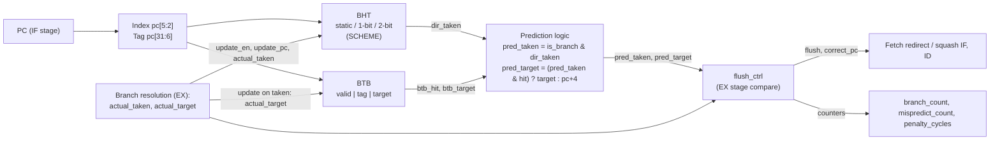

# Part 2 of 5 — Branch Target Buffer, Top-Level Integration and Synthesis

**Project:** Dynamic Branch Prediction Unit (Project 5, *Modern Computer Architecture – Verilog Projects*)
**Member:** Keshav
**Role:** Integration lead (BTB, top-level predictor, interface contract, build system, synthesis)

---

## 1. Team Division at a Glance

| Part | Member | Responsibility | Source files in the repository |
|---|---|---|---|
| 1 | Arun | Direction predictors: static baseline, 1-bit BHT, 2-bit BHT, FSM verification | `rtl/static_not_taken.v`, `rtl/bht_1bit.v`, `rtl/bht_2bit.v`, `testbench/tb_bht_fsm.v` |
| 2 | Keshav | BTB, update/selection logic, predictor top level, build system, synthesis | `rtl/btb.v`, `rtl/bp_update_logic.v`, `rtl/bp_select_logic.v`, `rtl/branch_predictor_top.v`, `testbench/tb_btb.v`, `synth/synth.ys`, `python/synth_report.py`, `Makefile`, `README.md` |
| 3 | Mayank | Pipeline flush/control, integrated unit `bpu_top`, MIPS workload | `rtl/flush_ctrl.v`, `rtl/bpu_top.v`, `testbench/tb_flush_ctrl.v`, `testbench/tb_bpu_top.v`, `python/mips_trace.py` |
| 4 | Rohit | Branch traces and the Python golden reference model | `python/trace_io.py`, `python/gen_traces.py`, `python/ref_model.py`, `traces/*.csv` |
| 5 | Sarvesh | System testbench, regression, accuracy/CPI analysis, final report | `testbench/tb_predictor.v`, `python/metrics.py`, `python/run_regression.py`, `python/analyze.py`, `results/`, `docs/report.md` |

> **The repository files are authoritative.** Code listings in this guide explain the design; where they differ from the file in the repository, the repository version is the one that was simulated and verified. Every file you own starts with a `// Owner:` or `Owner:` header line.

## 2. Your Responsibilities

1. Create and maintain the **repository structure**:
   ```
   rtl/  testbench/  python/  traces/  synth/  results/  docs/  Makefile  README.md  requirements.txt
   ```
2. Implement the **Branch Target Buffer** (`rtl/btb.v`): valid + tag + target, combinational lookup, update on taken branches.
3. Implement the **branch prediction update logic** (`rtl/bp_update_logic.v`): BHT write on every resolved branch, BTB write only on taken ones.
4. Implement the **branch prediction selection logic** (`rtl/bp_select_logic.v`): `pred_taken` and `pred_target` (BTB target or `pc + 4`).
5. Implement the **predictor top level** (`rtl/branch_predictor_top.v`): scheme selection (0 = NT, 1 = 1-bit, 2 = 2-bit) with `generate`, plus the BTB, update and selection logic.
6. Write the **BTB testbench** (`testbench/tb_btb.v`).
7. Own the **interface contract** (Section 4), the **Makefile**, and the **Yosys synthesis flow** (`synth/synth.ys`, `python/synth_report.py`).
8. Write report **Section 2** (architecture), the **BTB/top part of Section 4**, the **synthesis subsection**, and `README.md`.

## 3. Background Theory

### 3.1 Direction is not enough — the target problem

A direction predictor says *taken*, but the fetch stage also needs to know **where** to fetch from, and in the IF stage the instruction has not even been decoded yet. The **Branch Target Buffer** is a small cache, indexed by the branch PC, that remembers the target address of branches seen before. On a hit, fetch jumps straight to the stored target in the same cycle.

### 3.2 BTB organisation (direct-mapped)

```
 PC (32 bits)
 ┌──────────────────────────────┬──────────────┬────┐
 │  tag = pc[31:6]  (26 bits)   │ idx = pc[5:2]│ 00 │      (16-entry BTB)
 └──────────────┬───────────────┴──────┬───────┴────┘
                │                      │
                │        ┌─────────────▼───────────────────────────┐
                │        │ entry[idx]:  valid | tag[25:0] | target │
                │        └───┬──────────────┬──────────────┬───────┘
                │            │              │              │
                └──────► (==)◄──────────────┘              │
                             │                             │
                     valid AND equal ──► btb_hit        target ──► btb_target
```

| Field | Width (16 entries, 32-bit PC) | Purpose |
|---|---|---|
| valid | 1 | the entry holds real data (cleared on reset) |
| tag | `PC_WIDTH − INDEX_BITS − 2` = 26 | identifies **which** branch owns the entry |
| target | 32 | the predicted next PC |

Storage per entry = 1 + 26 + 32 = 59 bits. For 16 entries that is 944 bits.

**Tag vs no tag:** the BHT has no tag (a cheap guess is acceptable), but the BTB **must** have one. A wrong target sends fetch to an unrelated address, while a wrong direction only costs the misprediction penalty. The tag check turns an aliasing conflict into a BTB **miss**, which is safe.

### 3.3 Update policy

The BTB is written **only for branches that resolve taken**. A not-taken branch falls through to `PC + 4`, which fetch can compute without a table. Storing not-taken branches would only waste entries.

---

## 4. Interface Contract (shared with the whole team)

### 4.1 Global conventions

| Item | Agreed value |
|---|---|
| Language | Verilog-2005, synthesizable, `iverilog -Wall -g2005` clean |
| Clock / reset | single `clk`, **synchronous active-high** `rst` |
| Read ports | combinational (prediction ready in the same cycle as `pc`) |
| Write ports | `posedge clk`, gated by an enable |
| Index | `pc[INDEX_BITS+1:2]` (word-aligned PCs) |
| RTL rules | no latches, no `#` delays, no `initial` blocks in RTL |
| Prediction order assumption | each branch is updated before the next one is predicted (in-order, no overlapping in-flight branches) — documented in the report |

### 4.2 `branch_predictor_top` parameters

| Parameter | Default | Meaning |
|---|---|---|
| `PC_WIDTH` | 32 | PC width |
| `BHT_INDEX_BITS` | 4 | BHT entries = 2^N (16) |
| `BTB_INDEX_BITS` | 4 | BTB entries = 2^N (16) |
| `CTR_WIDTH` | 2 | counter width for scheme 2 |
| `SCHEME` | 2 | 0 = static NT, 1 = 1-bit, 2 = 2-bit |

### 4.3 `branch_predictor_top` ports

| Group | Port | Dir | Width | Meaning |
|---|---|---|---|---|
| — | `clk`, `rst` | in | 1 | clock, synchronous reset |
| Predict (IF) | `pc` | in | 32 | fetch PC |
| | `is_branch` | in | 1 | the fetched instruction is a branch |
| | `pred_taken` | out | 1 | predicted direction (`is_branch & dir_taken`) |
| | `pred_target` | out | 32 | next fetch PC: BTB target if predicted taken **and** BTB hit, otherwise `pc+4` |
| | `btb_hit` | out | 1 | BTB holds a matching entry |
| | `pred_state` | out | `CTR_WIDTH` | predictor state at `pc` (for waveforms) |
| Update (EX) | `update_en` | in | 1 | a branch resolves this cycle |
| | `update_pc` | in | 32 | PC of the resolved branch |
| | `actual_taken` | in | 1 | real direction |
| | `actual_target` | in | 32 | real target address |

### 4.4 Module ownership map

```
bpu_top                          (Mayank)  complete unit: predictor + flush control + next_pc mux
├── branch_predictor_top         (Keshav)
│   ├── bp_update_logic          (Keshav)  bht_we = update_en, btb_we = update_en & actual_taken
│   ├── g_static / g_1bit / g_2bit .u_dir  (Arun)  selected by SCHEME
│   ├── btb                      (Keshav)
│   └── bp_select_logic          (Keshav)  pred_taken, pred_target
└── flush_ctrl                   (Mayank)
tb_predictor                     (Sarvesh) drives bpu_top with CSV traces
```

## 5. Architecture Block Diagram (Report Section 2)



ASCII version for the printed report:

```
                 ┌───────────────────────── branch_predictor_top ─────────────────────────┐
   pc ──────────►│──► idx = pc[5:2] ──►┌────────────┐ dir_taken                           │
   is_branch ───►│                     │  BHT       ├──────────┐                          │
                 │                     │ (SCHEME)   │          ▼                          │
                 │                     └─────▲──────┘   ┌──────────────┐  pred_taken      │
                 │──► idx/tag ────────►┌─────┴──────┐   │  prediction  ├─────────────────►│──┐
                 │                     │   BTB      ├──►│    logic     │  pred_target     │  │
                 │                     │ v|tag|tgt  │hit│              ├─────────────────►│──┤
                 │                     └─────▲──────┘tgt└──────────────┘                  │  │
                 └───────────────────────────┼────────────────────────────────────────────┘  │
   update_en, update_pc, actual_taken, ──────┘ (BTB written only when actual_taken = 1)       │
   actual_target  (from EX stage)                                                             ▼
                                                                        ┌──────────── flush_ctrl ─┐
                                    actual_taken, actual_target ───────►│ mispredict? → flush,    │
                                                                        │ correct_pc, counters    │
                                                                        └─────────────────────────┘
```

---

## 6. Verilog Implementation

### 6.1 `rtl/btb.v`

```verilog
// btb.v -- Branch Target Buffer (direct-mapped).
// Each entry stores {valid, tag, target}. Lookup is combinational:
//   hit = valid[idx] && (tag[idx] == pc tag bits)
// An entry is written only when a branch is resolved TAKEN.
//   PC fields:  | tag : PC_WIDTH-1 .. INDEX_BITS+2 | index : INDEX_BITS+1 .. 2 | 00 |
module btb #(
    parameter PC_WIDTH   = 32,
    parameter INDEX_BITS = 4                    // entries = 2**INDEX_BITS
) (
    input  wire                 clk,
    input  wire                 rst,            // clears valid bits only
    // lookup port
    /* verilator lint_off UNUSEDSIGNAL */
    input  wire [PC_WIDTH-1:0]  pc,
    input  wire [PC_WIDTH-1:0]  update_pc,
    /* verilator lint_on UNUSEDSIGNAL */
    output wire                 hit,
    output wire [PC_WIDTH-1:0]  target,
    // update port
    input  wire                 update_en,      // = resolved branch AND taken
    input  wire [PC_WIDTH-1:0]  update_target
);
    localparam ENTRIES  = 1 << INDEX_BITS;
    localparam TAG_BITS = PC_WIDTH - INDEX_BITS - 2;

    reg [ENTRIES-1:0]  valid;
    reg [TAG_BITS-1:0] tag_mem    [0:ENTRIES-1];
    reg [PC_WIDTH-1:0] target_mem [0:ENTRIES-1];

    wire [INDEX_BITS-1:0] rd_idx = pc[INDEX_BITS+1:2];
    wire [TAG_BITS-1:0]   rd_tag = pc[PC_WIDTH-1:INDEX_BITS+2];
    wire [INDEX_BITS-1:0] wr_idx = update_pc[INDEX_BITS+1:2];
    wire [TAG_BITS-1:0]   wr_tag = update_pc[PC_WIDTH-1:INDEX_BITS+2];

    assign hit    = valid[rd_idx] && (tag_mem[rd_idx] == rd_tag);
    assign target = target_mem[rd_idx];

    // Valid bits need a reset; tag/target storage does not (RAM-friendly).
    always @(posedge clk) begin
        if (rst)
            valid <= {ENTRIES{1'b0}};
        else if (update_en)
            valid[wr_idx] <= 1'b1;
    end

    always @(posedge clk) begin
        if (update_en) begin
            tag_mem[wr_idx]    <= wr_tag;
            target_mem[wr_idx] <= update_target;
        end
    end
endmodule
```

**Why tag/target memories have no reset:** a stale tag or target is harmless while `valid = 0`, because `hit` is forced low. Leaving them unreset lets an FPGA tool map them to distributed RAM instead of reset flip-flops, which saves area.

### 6.2 Update logic, selection logic and the top level

**`rtl/bp_update_logic.v`** decides which tables learn from a resolved branch:

```verilog
assign bht_we = update_en;                  // every resolved branch trains the BHT
assign btb_we = update_en & actual_taken;   // only taken branches need a stored target
```

**`rtl/bp_select_logic.v`** makes the final fetch decision:

```verilog
assign pred_taken  = is_branch & dir_taken;
assign pred_target = (pred_taken & btb_hit) ? btb_target : pc_plus4;
```

**`rtl/branch_predictor_top.v`** wires them together: `bp_update_logic` → the scheme chosen by `generate` (`static_not_taken`, `bht_1bit` or `bht_2bit`, all written with `bht_we`) → `btb` (written with `btb_we`) → `bp_select_logic`. Open the file for the full port list (Section 4.3); it compiles with `iverilog -Wall` without warnings.

### 6.3 Design decisions to defend in the viva

| Decision | Reason |
|---|---|
| `SCHEME` is a **parameter** with `generate`, not a run-time input | Only the chosen predictor is built, so synthesis can report the **area of each scheme separately** (Section 8). The testbench compiles three binaries with `-Ptb_predictor.SCHEME=0/1/2`. |
| `pred_taken` reports the **raw direction**, even on a BTB miss | Direction accuracy stays a pure measure of the BHT. If the BHT says *taken* but the BTB misses, `pred_target = pc+4`, and Mayank's flush controller counts a **target misprediction**. This matches the required rule `pred_taken && actual_taken && pred_target != actual_target`. |
| BTB present in every scheme | BTB hit rate can be reported uniformly. In scheme 0, synthesis automatically removes the unused target storage (see Section 8). |
| Separate `BHT_INDEX_BITS` and `BTB_INDEX_BITS` | Sarvesh's size sweep changes the BHT alone, without changing the BTB. |

---

## 7. Build System — `Makefile`

The Makefile in the repository root is the single entry point. Run `make help` to list the targets.

| Target | What it does |
|---|---|
| `make traces` | `python/gen_traces.py` (7 traces) + `python/mips_trace.py` (`array_sum.csv`) |
| `make unit` | the 4 directed testbenches: `tb_bht_fsm`, `tb_btb`, `tb_flush_ctrl`, `tb_bpu_top`; logs in `results/logs/` |
| `make regression` | `python/run_regression.py`: 8 traces × 3 schemes against the golden model |
| `make test` | traces + unit + regression + BHT-size sweep; ends with `ALL TESTS PASSED` |
| `make wave` | VCD files in `results/waveforms/` |
| `make report` | `python/analyze.py`: tables and charts in `results/` |
| `make synth` | `python/synth_report.py`: Yosys for all three schemes |
| `make lint` | `iverilog -Wall` on every RTL file |
| `make demo` | short live demonstration |
| `make clean` | removes `build/` |

> Makefile recipe lines must start with a real **TAB** character.

## 8. Synthesis — `synth/synth.ys` and `python/synth_report.py`

The script synthesizes the **complete `bpu_top`** once per scheme, in two flows: generic gates (`synth -flatten`, `check -assert`, `ltp`) and Xilinx 7-series (`synth_xilinx -flatten`). Results are written to `results/synthesis/synthesis_summary.md`.

### 8.1 Actual results (Yosys 0.71, 16-entry BHT and BTB, 32-bit counters)

| Scheme | Generic cells | Flip-flops | Latches | Logic depth | Xilinx LUTs | Xilinx FFs | CARRY4 | LUTRAM (RAM32M) |
|---|---:|---:|---:|---:|---:|---:|---:|---:|
| Static NT | 1885 | 527 | 0 | 31 | 135 | 111 | 42 | 5 |
| 1-bit BHT | 2921 | 1055 | 0 | 31 | 197 | 127 | 42 | 11 |
| 2-bit BHT | 3029 | 1071 | 0 | 31 | 214 | 143 | 42 | 11 |

`check -assert` passed for every scheme: no latches, no undriven nets, no combinational loops.

**How to read these numbers**
- Generic flip-flops for the 2-bit scheme = 928 BTB tag/target bits + 16 valid bits + 32 counter bits + 95 performance-counter bits. One bit of `penalty_cycles` is constant 0, because the counter always grows by 2.
- 1-bit to 2-bit costs **+16 flip-flops, +108 cells (+3.7 %), +17 LUTs**.
- In the Xilinx flow, the BTB arrays map to distributed LUTRAM (RAM32M), which is why the FPGA flip-flop count is small.
- For static NT, Yosys removes the BTB target RAM: `pred_target` is always `pc+4` when nothing is predicted taken (constant propagation).
- Fmax needs place-and-route with timing constraints (Vivado). Yosys reports logic depth only, so the report does not quote a frequency.

## 9. `README.md`

The README is in the repository root. It covers requirements and install commands, quick-start `make` targets, the architecture and module hierarchy, the folder structure, and the headline results.

## 10. Interfaces with Teammates

| You give | To |
|---|---|
| Interface contract (Section 4) | everyone, before coding starts |
| `branch_predictor_top` with `pred_state` exposed | Sarvesh (testbench, waveform) |
| `pred_target` rule (BTB target only if predicted taken **and** hit) | Mayank (flush logic), Rohit (golden model must copy it) |
| BTB indexing/tag split and "update only on taken" policy | Rohit (golden model) |
| `make` targets | Sarvesh uses `make test/report/wave`; all members use `make unit` |
| Synthesis table (Section 8.1) | Sarvesh (report Section 6) |

| You need | From |
|---|---|
| Predictor modules with the agreed ports | Arun |
| `flush_ctrl.v` | Mayank |
| `gen_trace.py`, `ref_model.py` | Rohit |
| `tb_predictor.v`, `analyze.py` | Sarvesh |

---

## 11. Viva Preparation (Your Part)

1. **Why does the BTB need a tag when the BHT does not?**
   A wrong BHT guess only costs a few cycles. A wrong target would redirect fetch to an unrelated address. With the tag, an aliased lookup becomes a safe BTB miss (fetch `pc+4`).

2. **Why is the BTB updated only on taken branches?**
   The fall-through address `pc+4` is computed by an adder, so storing it is wasted capacity. Only taken targets need to be remembered.

3. **What happens when the BHT predicts *taken* but the BTB misses?**
   `pred_target` becomes `pc+4`, so fetch effectively continues as if not taken. If the branch is really taken, `flush_ctrl` raises a target misprediction and redirects fetch to `actual_target`.

4. **Why is the scheme a parameter and not an input signal?**
   With a parameter and `generate`, only one predictor is built. This keeps the hardware realistic and allows a per-scheme area comparison (1885 / 2921 / 3029 cells for the complete `bpu_top`).

---

## 12. Deliverables Checklist

- [x] Repository skeleton, `.gitignore`, `requirements.txt`
- [x] `rtl/btb.v`, `rtl/bp_update_logic.v`, `rtl/bp_select_logic.v`, `rtl/branch_predictor_top.v` — lint-clean
- [x] `testbench/tb_btb.v` — `PASS tb_btb`
- [x] `Makefile` (`help / traces / unit / regression / test / wave / report / synth / lint / demo / clean`)
- [x] `synth/synth.ys` + `python/synth_report.py` → `results/synthesis/`
- [x] `README.md`
- [ ] Optional: Fmax from Vivado place-and-route
